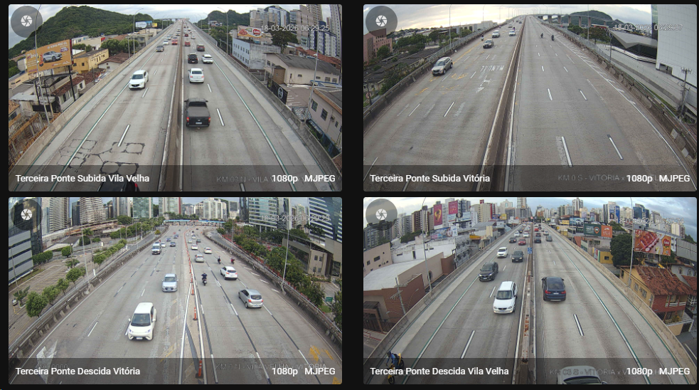

# ha-terceira-ponte

[![HACS][badge-hacs]][link-hacs]
[![GitHub Release][badge-release]][link-release]
[![GitHub Commit Activity][badge-commit-activity]][link-commits]
[![HACS Validation][badge-hacs-validation]][link-hacs-validation]
[![Hassfest][badge-hassfest]][link-hassfest]

Integração Terceira Ponte para Home Assistant.

Integração customizada para Home Assistant que expõe as quatro câmeras
públicas da Terceira Ponte, em Vitória/ES, como entidades `camera`.

As imagens são obtidas do serviço da CETURB-ES com autenticação JWT pública
e cache curto para reduzir requisições duplicadas quando o dashboard é aberto.



## Recursos

- 4 entidades `camera` fixas, com os mesmos nomes do site da CETURB
  (sentido do tráfego):
  - `Subida Sentido Vila Velha`
  - `Descida Sentido Vila Velha`
  - `Subida Sentido Vitória`
  - `Descida Sentido Vitória`
- Configuração por UI em `Configurações > Dispositivos e Serviços`
- Cache configurável nas opções da integração
- Renovação automática do token JWT
- Compatível com HACS

## Instalação

Requer Home Assistant 2025.8 ou mais recente.

### HACS

[![Abrir este repositório no HACS][badge-my-hacs]][link-my-hacs]

Ou, manualmente:

1. Adicione este repositório como repositório customizado no HACS.
2. Selecione a categoria `Integration`.
3. Instale a integração `Terceira Ponte`.
4. Reinicie o Home Assistant.

### Manual

1. Copie a pasta `custom_components/terceira_ponte` para `custom_components`.
2. Reinicie o Home Assistant.

## Configuração

1. Vá em `Configurações > Dispositivos e Serviços`.
2. Adicione a integração `Terceira Ponte`.
3. Confirme a configuração.
4. Se quiser ajustar o cache, abra `Configurar` nas opções da integração.

## Exemplo: resumo do trânsito com IA

O feed não traz dados de trânsito, mas o Home Assistant pode analisar a imagem
com qualquer integração de IA que ofereça uma entidade AI Task (OpenAI, Google
Gemini, Ollama etc.). Esta automação manda, em dias úteis às 7h, uma
notificação com a foto e um resumo do trânsito:

```yaml
alias: Trânsito na Terceira Ponte
triggers:
  - trigger: time
    at: "07:00:00"
conditions:
  - condition: time
    weekday: [mon, tue, wed, thu, fri]
actions:
  - action: ai_task.generate_data
    data:
      task_name: Trânsito Terceira Ponte
      instructions: >-
        Esta é uma câmera da Terceira Ponte, em Vitória/ES. Diga em uma frase
        curta se o trânsito está livre, moderado ou congestionado.
      attachments:
        - media_content_id: media-source://camera/camera.ceturb_terceira_ponte_subida_sentido_vila_velha
          media_content_type: image/jpeg
    response_variable: transito
  - action: notify.mobile_app_seu_celular
    data:
      title: Terceira Ponte
      message: "{{ transito.data }}"
      data:
        image: /api/camera_proxy/camera.ceturb_terceira_ponte_subida_sentido_vila_velha
```

Ajuste o `entity_id` da câmera e o serviço `notify` para os da sua instalação.

## Limitações conhecidas

- O feed é snapshot JPEG, não stream de vídeo.
- A disponibilidade depende do serviço público da CETURB-ES.
- O backend observado em 12 de março de 2026 exige JWT público e muda as
  imagens em intervalos curtos, mas sem contrato público documentado de
  atualização.

## Fonte das imagens

As imagens públicas são disponibilizadas pela CETURB-ES em:

<https://terceiraponte.ceturb.es.gov.br/>

[badge-hacs]: https://img.shields.io/badge/HACS-Custom-41BDF5.svg
[badge-release]: https://img.shields.io/badge/dynamic/json?url=https%3A%2F%2Fapi.github.com%2Frepos%2Fchiconws%2Fha-terceira-ponte%2Freleases%2Flatest&query=%24.tag_name&label=release
[badge-commit-activity]: https://img.shields.io/github/commit-activity/m/chiconws/ha-terceira-ponte
[badge-hacs-validation]: https://github.com/chiconws/ha-terceira-ponte/actions/workflows/hacs.yaml/badge.svg
[badge-hassfest]: https://github.com/chiconws/ha-terceira-ponte/actions/workflows/hassfest.yaml/badge.svg
[link-hacs]: https://github.com/custom-components/hacs
[link-release]: https://github.com/chiconws/ha-terceira-ponte/releases/latest
[link-commits]: https://github.com/chiconws/ha-terceira-ponte/commits/main
[link-hacs-validation]: https://github.com/chiconws/ha-terceira-ponte/actions/workflows/hacs.yaml
[link-hassfest]: https://github.com/chiconws/ha-terceira-ponte/actions/workflows/hassfest.yaml
[badge-my-hacs]: https://my.home-assistant.io/badges/hacs_repository.svg
[link-my-hacs]: https://my.home-assistant.io/redirect/hacs_repository/?owner=chiconws&repository=ha-terceira-ponte&category=integration
